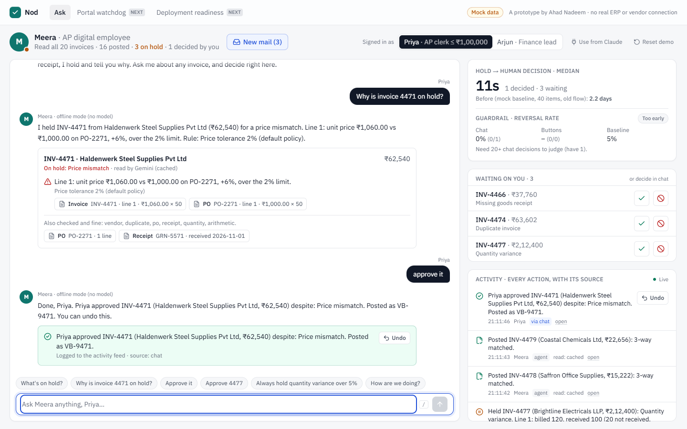

# Nod

**Talk to your AI accounts-payable employee like a coworker: ask why something is on hold, and approve or reject it right there.**

**Live demo:** https://onyourdeskside.vercel.app · **Decisions:** [DECISIONS.md](DECISIONS.md) · **Pitch:** [PITCH.md](PITCH.md) · **Video script:** [VIDEO_SCRIPT.md](VIDEO_SCRIPT.md)

> **All data is mock data.** Vendors, invoices, purchase orders, goods receipts, paid bills and the "before" baseline are synthetic. There is no real ERP connection, and Nod is not a Zamp product or integration. It's a prototype of a layer that would sit on top of one.



## Why
AI employees already do most of accounts payable. When one holds an invoice, the finance lead has to go to another tool to find out why. **Hypothesis:** held items sit for days and trust stalls.

- **North star:** the median time from the agent holding an item to a human decision.
- **Guardrail:** the reversal rate on decisions made via chat must not exceed the rate for decisions made with buttons.

## What it does
| | |
|---|---|
| **Ask** | "Why is invoice 4471 on hold?" gets a grounded answer with chips for the exact invoice, PO and receipt lines. Click one to see the PDF beside the highlighted lines. |
| **Decide in chat** | "Approve it" / "reject it" lands in the live activity feed with its source (chat, button, MCP, rule) and a one-click undo. |
| **Trust model** | The AP clerk approves up to ₹1,00,000; the finance lead approves anything. Over the limit, Meera refuses, explains, and escalates. Every action is logged. |
| **Remembers rules** | "Always hold quantity variance over 5%" becomes rule R-1 and applies to the next invoices that arrive. Rules can only make Meera stricter. |
| **Metric card** | Live hold → decision median against the mock baseline, plus chat vs button reversal rates with a sample-size gate. |
| **Use from Claude** | The same tools over MCP (`/api/mcp`), under the same permissions and log. |
| **Next (thin)** | *Portal watchdog*, a static, labelled example alert, and *Deployment readiness*, which runs sample (or uploaded) invoices to show what would be auto-decided and what would go to review. |

### The inbox
- **20 invoices from 5 vendors.** Meera reads each PDF with Gemini, then 3-way matches it in code.
- **Four planted exceptions:**
  - `INV-4471`: price ₹1,060 vs PO ₹1,000 (+6%);
  - `INV-4466`: no goods receipt;
  - `INV-4474`: `KPC-42` duplicates `KPC/0042`, already paid;
  - `INV-4477`: billed 120, received 100. At ₹2.1 lakh it's also above the clerk's limit.
- **Within tolerance passes:** `INV-4463` (+1.2%) passes with a note.
- **"New mail":** 3 more invoices arrive later. `INV-4481` (+7% quantity) passes by default but is held once a 5% rule exists.

## How it works
```
Browser (chat · feed · metric card)
   │  /api/chat ──► Gemini function-calling ──┐   (offline router if Gemini is unavailable)
   │  /api/decide, /api/undo (buttons) ───────┤
   │  /api/mcp (Claude) ──────────────────────┤
   ▼                                          ▼
                 tools.ts: list_held · explain_invoice · approve · reject · undo · create_hold_rule · get_metrics
                                              │
             authorize() (roles, limits) ─► service.ts ─► events (append-only: actor, role, source, undo links)
                                              │
             match.ts (3-way match + citations) · policy.ts (tolerances + rules) · metrics.ts
                                              │
                 Postgres (Neon in prod, PGlite locally) · Gemini PDF reads (live / cached / fallback)
```
- **The model talks; code decides.** Permissions, matching and rules are deterministic, unit-tested TypeScript. The model can't take a write action the user's own words didn't ask for.
- **Citations are structured output from the match engine**, rendered as chips. They are never model text.
- **Honest labels:** every PDF read shows *live*, *cached* (a real earlier Gemini answer from the committed snapshot) or *fallback*. Chat replies say "Gemini" or "offline mode".

## Run it
Requires Node 20.19+ (22 LTS recommended).
```bash
npm install
npm run dev     # http://localhost:3000. No database or API key needed.
```
- **No `DATABASE_URL`:** an in-process Postgres (PGlite) is created in `.data/`.
- **No `GEMINI_API_KEY`:** PDF reads come from the committed snapshot of real Gemini reads, and chat runs in offline mode.

Optional `.env.local` (never committed):
```bash
GEMINI_API_KEY=...                  # live chat and live reads (free tier is fine)
GEMINI_MODEL=gemini-3.5-flash-lite  # override the model
DATABASE_URL=postgres://...         # Neon or any Postgres
```

### Tests
```bash
npm test             # 44 unit tests: match engine, rules, trust model, metrics, intent router, Gemini snapshot accuracy
npm run e2e          # the video's exact flow + MCP, in real Chrome, offline mode, fresh in-memory DB
E2E_BASE_URL=https://onyourdeskside.vercel.app npm run e2e   # same tests against the live site
npm run pdfs         # regenerate the mock invoice PDFs (deterministic bytes)
npm run cache:export # snapshot live Gemini reads from the local DB (stop the dev server first)
```

### Deploy
Import the repo into Vercel, add Neon Postgres from the Marketplace (it sets `DATABASE_URL`), and set `GEMINI_API_KEY` as a sensitive environment variable.

### Use from Claude (MCP)
Click **Use from Claude** on the desk to copy a URL like `https://<host>/api/mcp?ws=<workspace>&as=<person>`, then add it as a custom connector in Claude. Demo auth: the URL is the key. A real deployment would use OAuth and SSO identities.

## Repo map
```
src/components/desk/        chat, activity feed, metric card, document drawer, useDesk (polling + paced agent loop)
src/lib/chat/               tools (shared by chat and MCP), Gemini engine, offline intent router
src/lib/match.ts            3-way match, duplicates, citations
src/lib/policy.ts           tolerances, rule parsing (rules only tighten)
src/lib/authz.ts            roles and limits
src/lib/metrics.ts          north star + guardrail
src/lib/service.ts          the agent loop and every state change, all logged
src/lib/data/               mock seed, samples, mock baseline, Gemini snapshot
src/app/api/mcp/            MCP endpoint
src/app/watchdog, readiness the two thin "next" tabs
e2e/                        Playwright: the demo script + MCP
```

Built by Ahad Nadeem.
